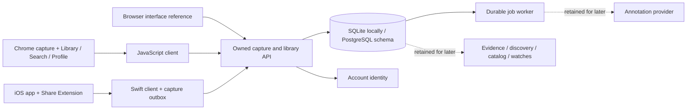

# Mymah Finds — backend architecture

Mymah Finds has a shared backend and two product surfaces: Chrome/browser and native iOS. Haydn owns backend behavior; separate teammates own the interfaces. The immediate product is a personal saved-content library with **Library**, **Search**, and **Profile** navigation. Capture, finding saved content, reopening original links, deletion, and account isolation come first. Intelligence and commerce remain later work.

The source briefs supplied product context, not instructions to connect external accounts or publish anything. User-visible screens use the Mymah Finds brand and contain no prototype/demo labels or developer diagnostics. Technical limitations remain documented here so removing those screens does not imply that future services are production-ready.

## Current integration boundary

`POST /v1/saves` stores supplied URL/title/text/note and enqueues enrichment in one transaction. The current UI treats the API receipt as a successful save and renders the supplied content. Enrichment is independent background behavior; suggestions or failures do not gate the library. The UI must not call hypothesis, discovery, catalog, watch, notification, or trace endpoints to populate its three main destinations.

Library reads use `GET /v1/collection` and `GET /v1/saves/{id}`. Profile reads identity through `GET /v1/me`. The browser reference loads all collection pages and searches titles, notes, selected text, source, and URLs locally. There is no dedicated server search endpoint. Other clients must load the intended search scope or coordinate a paginated search API before claiming complete-library coverage. `DELETE /v1/saves/{id}` removes a save from the active library and invalidates dependent evidence and cached mutation results.

| Module | Files | Responsibility |
| --- | --- | --- |
| Public contracts | `backend/app/contracts.py`, `responses.py`, `contracts/` | Bounded inputs, typed outputs, generated OpenAPI, capability flags |
| Persistence | `backend/app/db.py`, `backend/migrations/` | User-owned records, JSON/JSONB, schema migrations |
| API | `backend/app/main.py` | Auth, ownership, capture/library reads, transactional mutations, idempotency, errors |
| Jobs | `backend/app/worker.py` | Leases, expiry recovery, bounded retries, guarded publication |
| Browser reference | `frontend/` | Mymah Finds Library/Search/Profile, capture, saved-item detail, deletion and account state |
| Chrome | `extension/`, `clients/javascript/` | MV3 popup/worker/settings, explicit capture, session retry state, shared client |
| iOS | `clients/ios/` | Swift client, durable capture outbox, host/share templates, App Group + Keychain |
| Retained intelligence | `backend/app/intelligence.py` and related routes | Demo annotation provider, evidence rules, versioned discovery; not current UI scope |
| Retained commerce | `backend/app/catalog.json`, watch/observation/job models | Fictional catalog, filters, simulated tracking; not current UI scope |

Existing API paths and `CommonThread` SDK symbols retain older internal names for compatibility. User-visible naming is Mymah Finds. See the [team handoff](team-handoff.md) for ownership, platform reminders, and current acceptance criteria.

## Capture and library invariants

Every record belongs to an authenticated backend user. Different interface tokens can map to the same user; sharing a backend and user identity shares a library. Changing accounts or API origins must never replay another account's queued captures.

Mutation requests require a retained idempotency key. Repeating the exact request replays its result; using the key for different content returns 409. Deletion scrubs cached mutation results while retaining invalidated identities, so a delayed retry receives 410 rather than restoring a deleted save. A deliberate new save uses a new key.

URL canonicalization removes fragments and known marketing parameters. A duplicate canonical URL returns the existing save without replacing its title, note, or selected text. There is no saved-metadata edit endpoint yet. Clients must report duplicate behavior accurately.

The `client` field records the initial capture surface, or the latest restoration after deletion. `source` identifies the content platform. Neither field implies a platform account connection. The backend stores supplied links and content; it does not fetch arbitrary URLs, scrape accounts, or accept image/video uploads.

Library lists use offset pagination with a stable ordering for unchanged data. Concurrent inserts/deletes can shift offsets. Clients refresh from offset zero on foreground or after mutations and deduplicate appended IDs. There is no delta-sync protocol or push update channel.

SQLite mutations reserve the writer transaction before reading state. PostgreSQL serializes API mutations through the user's state row. The worker claims with a conditional update and lease token. Publication and job completion share a transaction; failures roll back partial work. Long-running remote inference is not implemented; before adding it, move network calls outside row locks and guard the final save revision/context before publishing.

## Retained future behavior

These modules remain for backend iteration and regression coverage. Frontend teammates should not connect them to Library/Search/Profile yet.

Suggestions become evidence only after selection or replacement with explicit user text. Rejection invalidates earlier evidence for that suggestion. Uncertain free text remains unresolved. Identical normalized selected text shares a support group, so repeated annotation cannot inflate support. Semantic near-duplicate detection is not implemented.

The desk-lighting hypothesis requires two independent confirmed non-neutral groups before an invitation, with suppression/cooldown handling. Its score is a decayed heuristic, not purchase readiness or a probability. Versioned discovery sessions preserve evidence IDs; removing supporting evidence hides the shortlist and blocks further selection. These rules are not a request to add generated interpretation or shopping invitations to the current product.

Commerce uses fictional catalog variants and manually simulated price observations. Prices are integer minor units with currency; budgets exclude shipping, which may be unknown. Observations match exact variant/currency, and rule changes invalidate queued checks. Crossing episodes deduplicate in-app notification records. No live merchant integration, verified purchase link, recurring price scheduler, checkout, or push provider is connected.

## Implementation priorities

1. **Library experience:** build Mymah Finds Library/Search/Profile and fast explicit capture. Verify saved content, original-link navigation, empty/search/no-result states, deletion, and accessible platform navigation.
2. **Shared-account integration:** verify cross-surface refresh, permission denial, account changes, pending capture recovery, and retained mutation identity after interrupted requests.
3. **Search coverage:** validate search against pagination and growing libraries. Add a user-scoped search API with a matching/sorting contract when client-side coverage is insufficient.
4. **Backend readiness:** exercise migrations and concurrent behavior on live PostgreSQL, add production identity, deployment/operational limits, and retention/erasure policy.
5. **Broader media:** agree on uploads, content types, extraction limits, and permissions before adding images/screenshots/video to either interface.
6. **Intelligence and commerce later:** integrate and evaluate a real annotation provider, verified merchant records, reliable tracking, and notification channels only after product scope expands. Keep those services separate from capture durability and confirmed user intent.
