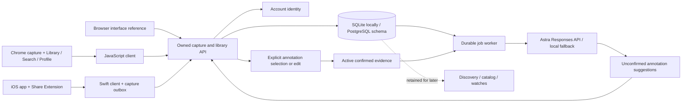

# Mymah Finds — backend architecture

Mymah Finds has a shared FastAPI backend and two product surfaces: Chrome/browser and native iOS. Haydn owns backend behavior; separate teammates own the interfaces. The product is a personal saved-content library with **Library**, **Search**, and **Profile** navigation. The next interface feature is [predictive annotations](predictive-annotations.md) for saved images and links. Capture remains immediate and durable. Discovery, commerce presentation and action scheduling remain later work; the source-aware catalog backend is described in [catalog integration](catalog-integration.md).

The source briefs supplied product context, not instructions to connect external accounts or publish anything. User-visible screens use the Mymah Finds brand and contain no prototype/demo labels or developer diagnostics. Technical limitations remain documented here so removing those screens does not imply that future services are production-ready.

## Current integration boundary

`POST /v1/saves` stores a URL, validated image, or both with supplied title/text/note and enqueues enrichment in one transaction. The API receipt confirms the save before enrichment completes. Optional annotation chips can arrive afterward; failures do not gate the library. `POST /v1/saves/{id}/responses` records a user-confirmed annotation with `execution_status: annotation_only`; it does not purchase, schedule a reminder, or start monitoring. Hypothesis, discovery, catalog, watch, notification and trace endpoints remain outside the current interface flow.

Library reads use `GET /v1/collection` and `GET /v1/saves/{id}`. Profile reads identity through `GET /v1/me`. The browser reference loads all collection pages and searches titles, notes, selected text, source, and URLs locally. There is no dedicated server search endpoint. Other clients must load the intended search scope or coordinate a paginated search API before claiming complete-library coverage. `DELETE /v1/saves/{id}` removes a save from the active library and invalidates dependent evidence and cached mutation results.

| Module | Files | Responsibility |
| --- | --- | --- |
| Public contracts | `backend/app/contracts.py`, `responses.py`, `contracts/` | Bounded inputs, typed outputs, generated OpenAPI, capability flags |
| Persistence | `backend/app/db.py`, `backend/migrations/` | User-owned records, JSON/JSONB, schema migrations |
| API | `backend/app/main.py` | Auth, ownership, capture/library reads, transactional mutations, idempotency, errors |
| Jobs | `backend/app/worker.py` | Leases, expiry recovery, bounded retries, guarded publication |
| Predictive annotations | `backend/app/predictive.py` | Backend-only Astra configuration, bounded vision request, structured output validation and intent options |
| Private media | `backend/app/media.py`, `request_limits.py` | Image validation/normalization, metadata removal and bounded request bodies |
| Browser reference | `frontend/` | Mymah Finds Library/Search/Profile, capture, saved-item detail, deletion and account state |
| Chrome | `extension/`, `clients/javascript/` | MV3 popup/worker/settings, explicit capture, session retry state, shared client |
| iOS | `clients/ios/` | Swift client, durable capture outbox, host/share templates, App Group + Keychain |
| Retained intelligence | `backend/app/intelligence.py` and related routes | Legacy deterministic provider, desk hypotheses and versioned discovery; not current UI scope |
| Retained commerce | `backend/app/catalog.json`, watch/observation/job models | Fictional catalog, filters, simulated tracking; not current UI scope |
| Catalog integration | `backend/app/catalog/`, `catalog_*` tables | Licensed local datasets, separate synthetic scenarios, exports and optional approved feeds; separate from private evidence and legacy fixtures |

Existing API paths and `CommonThread` SDK symbols retain older internal names for compatibility. User-visible naming is Mymah Finds. See the [team handoff](team-handoff.md) for ownership, platform reminders, and current acceptance criteria.

## Capture and library invariants

Every record belongs to an authenticated backend user. Different interface tokens can map to the same user; sharing a backend and user identity shares a library. Changing accounts or API origins must never replay another account's queued captures.

Mutation requests require a retained idempotency key. Repeating the exact request replays its result; using the key for different content returns 409. Deletion scrubs cached mutation results while retaining invalidated identities, so a delayed retry receives 410 rather than restoring a deleted save. A deliberate new save uses a new key.

URL canonicalization removes fragments and known marketing parameters. A duplicate canonical URL returns the existing save without replacing its title, note, or selected text. There is no saved-metadata edit endpoint yet. Clients must report duplicate behavior accurately.

The `client` field records the initial capture surface, or the latest restoration after deletion. `source` identifies the content platform. Neither field implies a platform account connection. The backend stores supplied links and image bytes; it does not fetch arbitrary URLs or scrape accounts. Video is unsupported.

Image input is a base64 JPEG/PNG/WebP data URL, limited to 4 MiB of decoded bytes; the complete request body is limited to 6 MiB. The backend validates dimensions and static image content, normalizes orientation, and re-encodes without source metadata before storage or model use. Image-only saves use a private content-derived identity and an empty `original_url`. Image storage is deferred in ORM list queries and excluded from JSON views. Clients receive `has_image` and an authenticated `/v1/saves/{id}/image` path; ownership is checked on retrieval. Deletion removes the stored image.

Library lists use offset pagination with a stable ordering for unchanged data. Concurrent inserts/deletes can shift offsets. Clients refresh from offset zero on foreground or after mutations and deduplicate appended IDs. There is no delta-sync protocol or push update channel.

SQLite mutations reserve the writer transaction before reading state. PostgreSQL serializes API mutations through the user's state row. The worker claims a job through a conditional update and a 60-second lease token, then snapshots the capture and at most eight recent active preferences from that user's nondeleted saves. Only confirmed annotations and explicit statements qualify; each preference is bounded to 300 characters. No generated suggestion becomes evidence automatically.

The worker closes its transaction before calling the fixed official Responses endpoint. Astra has a 40-second total request deadline, below the job lease; response size and structured fields are bounded. Keys remain on the server. Configured provider failures remain visible as retries or enrichment failure and never silently become successful Astra output through the no-key fallback.

Publication takes a short transaction and the same per-user PostgreSQL lock as API mutations. It rechecks the preference snapshot, active lease, ownership, revision and pending status before publishing. Publication and job completion are atomic; a stale worker cannot overwrite a newer revision or mark it failed. Stored prediction provenance includes the supporting evidence IDs. Removing or rejecting supporting evidence retracts already-published dependent predictions, clears their suggestions, increments each affected save's revision and queues fresh enrichment. An in-flight response based on revoked context is discarded and retried.

## Confirmed evidence and retained discovery behavior

The remaining hypothesis, discovery and commerce modules support backend iteration and regression coverage. Frontend teammates should connect only the new capture/annotation flow described above.

Suggestions become evidence only after selection or replacement with explicit user text. Rejection invalidates earlier evidence for that suggestion. Uncertain free text remains unresolved. Identical normalized selected text shares a support group, so repeated annotation cannot inflate support. Semantic near-duplicate detection is not implemented.

The desk-lighting hypothesis requires two independent confirmed non-neutral groups before an invitation, with suppression/cooldown handling. Its score is a decayed heuristic, not purchase readiness or a probability. Versioned discovery sessions preserve evidence IDs; removing supporting evidence hides the shortlist and blocks further selection. These rules are not a request to add generated interpretation or shopping invitations to the current product.

Legacy discovery/watch routes use fictional catalog variants and manually simulated price observations. Prices are integer minor units with currency; budgets exclude shipping, which may be unknown. Observations match exact variant/currency, and rule changes invalidate queued checks. Crossing episodes deduplicate in-app notification records. They do not consume the new catalog sources. `/v1/commerce/*` independently exposes licensed local datasets and explicitly synthetic sources without provider accounts. Real dataset records retain unknown merchant/price/stock fields. Approved affiliate imports remain optional. Recurring price scheduling, checkout and push remain unimplemented.

## Implementation priorities

1. **Library experience:** build Mymah Finds Library/Search/Profile and fast explicit capture. Verify saved content, original-link navigation, empty/search/no-result states, deletion, and accessible platform navigation.
2. **Shared-account integration:** verify cross-surface refresh, permission denial, account changes, pending capture recovery, and retained mutation identity after interrupted requests.
3. **Search coverage:** validate search against pagination and growing libraries. Add a user-scoped search API with a matching/sorting contract when client-side coverage is insufficient.
4. **Backend readiness:** exercise migrations and concurrent behavior on live PostgreSQL, add production identity, deployment/operational limits, and retention/erasure policy.
5. **Images and annotations:** connect explicit image selection, iOS image-share/HEIC conversion, authenticated image display, and optional annotation chips. Run the paid Astra smoke check with backend credentials, then evaluate representative captures and latency. Keep provider configuration out of the interfaces.
6. **Commerce and external context later:** connect verified merchant offers, reliable tracking, reminder delivery and notification channels only through separate confirmed-action contracts. Dots knowledge access remains deferred; a ChatGPT sign-in does not supply personal memory. Keep these services separate from capture durability and confirmed user intent.
