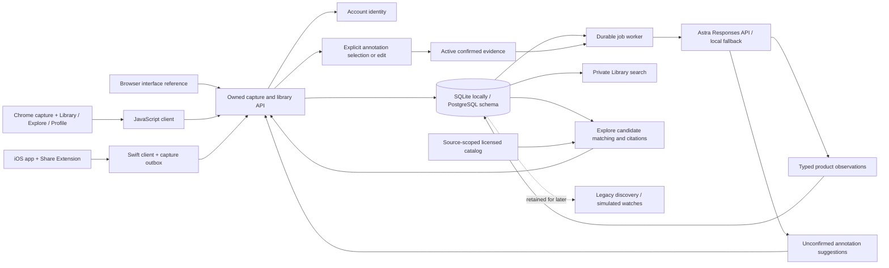

# Mymah Finds — backend architecture

Mymah Finds has a shared FastAPI backend and two product surfaces: Chrome/browser and native iOS. Haydn owns backend behavior; teammates own the interfaces. The agreed navigation is **Library**, **Explore**, and **Profile**. Contract **0.4.0** supports structured product observations, predictive annotations, private Library search and cited Explore recommendations. Capture remains immediate and durable. Existing native/browser views still need to adopt this plan; see the [AI integration guide](ios-ai-handoff.md). Legacy desk discovery and action scheduling remain separate work.

The source briefs supplied product context, not instructions to connect external accounts or publish anything. User-visible screens use the Mymah Finds brand and contain no prototype/demo labels or developer diagnostics. Technical limitations remain documented here so removing those screens does not imply that future services are production-ready.

## Current integration boundary

`POST /v1/saves` stores a URL, validated image, or both with supplied title/text/note and enqueues enrichment in one transaction. The receipt confirms the save before product analysis and optional annotation chips arrive. `POST /v1/saves/{id}/responses` records a user-confirmed annotation and can queue analysis refinement; `execution_status: annotation_only` does not purchase, schedule or start monitoring. `POST /v1/saves/{id}/analyze` explicitly queues fresh analysis, including retry after failure.

Library uses `GET /v1/collection`, `GET /v1/saves/{id}` and `GET /v1/library/search`. Search matches the current user's saved text, active explicit annotations and analyzed product facets, with category filtering and pagination. Explore uses `GET /v1/explore`, with an optional query for catalog search. Profile reads `GET /v1/me`. The browser reference's older local filter is not the new server search flow. Deleting a save withdraws its Library entry, dependent evidence/derived predictions and cached mutation results; Explore always derives from current active context.

| Module | Files | Responsibility |
| --- | --- | --- |
| Public contracts | `backend/app/contracts.py`, `responses.py`, `understanding.py`, `explore.py`, `contracts/` | Bounded inputs, typed observations/results, generated OpenAPI and capability flags |
| Persistence | `backend/app/db.py`, `backend/migrations/` | User-owned records, JSON/JSONB, schema migrations |
| API | `backend/app/main.py` | Auth, ownership, capture/library reads, transactional mutations, idempotency, errors |
| Jobs | `backend/app/worker.py` | Leases, expiry recovery, bounded retries, guarded publication |
| Predictive annotations | `backend/app/predictive.py` | Backend-only Astra configuration, bounded vision request, structured output validation and intent options |
| Product observations | `backend/app/understanding.py` | Hierarchical categories, source-attributed identity/attributes, explicit uncertainty and deterministic search facets |
| Library search | `backend/app/library.py` | Owned search documents, confirmed-note and observation indexing, query/category matching and pagination |
| Explore | `backend/app/explore.py` | Bounded catalog candidates, matching to current saved observations, explanations, evidence/catalog citations and offer actions |
| Private media | `backend/app/media.py`, `request_limits.py` | Image validation/normalization, metadata removal and bounded request bodies |
| Browser reference | `frontend/` | Existing capture/Library/detail/account scaffold; new Library/Explore/Profile presentation remains teammate work |
| Chrome | `extension/`, `clients/javascript/` | MV3 popup/worker/settings, explicit capture, session retry state, shared client |
| iOS | `clients/ios/` | Swift client, durable capture outbox, host/share templates, App Group + Keychain |
| Retained intelligence | `backend/app/intelligence.py` and related routes | Legacy deterministic provider, desk hypotheses and versioned discovery; not current UI scope |
| Retained commerce | `backend/app/catalog.json`, watch/observation/job models | Fictional catalog, filters, simulated tracking; not current UI scope |
| Catalog integration | `backend/app/catalog/`, `catalog_*` tables | Licensed local datasets, separate synthetic scenarios, exports and optional approved feeds; separate from private evidence and legacy fixtures |

Existing API paths and `CommonThread` SDK symbols retain older internal names for compatibility. User-visible naming is Mymah Finds. See the [team handoff](team-handoff.md) for ownership, platform reminders, and current acceptance criteria.

## Capture and library invariants

Every record belongs to an authenticated backend user. Different interface tokens can map to the same user; sharing a backend and user identity shares a library. Changing accounts or API origins must never replay another account's queued captures.

Mutation requests require a retained idempotency key. Repeating the exact request replays its result; using the key for different content returns 409. Deletion scrubs cached mutation results while retaining invalidated identities, so a delayed retry receives 410 rather than restoring a deleted save. A deliberate new save uses a new key.

URL canonicalization removes fragments and known marketing parameters. A duplicate canonical URL returns the existing save without replacing its title, note, or selected text. There is no saved-metadata edit endpoint yet. Clients must report duplicate behavior accurately.

The `client` field records the initial capture surface, or the latest restoration after deletion. `source` identifies the content platform. Neither implies a platform account connection. The backend does not fetch pages or remote images from a saved URL: URL-only understanding uses supplied title/text/note. Actual image bytes are required for vision. Video and audio understanding are unsupported.

Image input is a base64 JPEG/PNG/WebP data URL, limited to 4 MiB of decoded bytes; the complete request body is limited to 6 MiB. The backend validates dimensions and static image content, normalizes orientation, and re-encodes without source metadata before storage or model use. Image-only saves use a private content-derived identity and an empty `original_url`. Image storage is deferred in ORM list queries and excluded from JSON views. Clients receive `has_image` and an authenticated `/v1/saves/{id}/image` path; ownership is checked on retrieval. Deletion removes the stored image.

Library lists use offset pagination with a stable ordering for unchanged data. Concurrent inserts/deletes can shift offsets. Clients refresh from offset zero on foreground or after mutations and deduplicate appended IDs. There is no delta-sync protocol or push update channel.

SQLite mutations reserve the writer transaction before reading state. PostgreSQL serializes API mutations through the user's state row. The worker claims a job through a conditional update and a 60-second lease, then snapshots the capture, current-save explicit annotations and at most eight recent active preferences from that user's nondeleted saves. Source IDs are retained for revocation checks. Historical preferences rank suggested actions; they must not supply the captured object's brand or category. No generated observation or suggestion becomes confirmed evidence automatically.

The worker closes its transaction before calling the fixed official Responses endpoint. Astra has a 40-second total request deadline, below the job lease; response size and structured fields are bounded. Keys remain on the server. Configured provider failures remain visible as retries or enrichment failure and never silently become successful Astra output through the no-key fallback.

Publication takes a short transaction and the same per-user PostgreSQL lock as API mutations. It rechecks preference and current-annotation snapshots, lease, ownership, revision and pending status before publishing. Publication, search-document refresh and job completion are atomic; a stale worker cannot overwrite a newer revision or mark it failed. Stored prediction provenance includes supporting evidence IDs. Removing or rejecting supporting evidence withdraws published dependent analysis/search facets, increments affected revisions and queues fresh enrichment. In-flight responses based on revoked context are discarded. Confirmed intent remains retractable across reanalysis, even when a proposal is regenerated.

## Product understanding and Explore

Astra returns `ProductAnalysis` schema version 1 with a summary and up to four product observations. Each observation has a broad-to-specific category path, nullable brand/model facts, supported named attributes, use cases and search terms. Brand/model require an observed name in visible or explicitly supplied text. Their evidence identifies the source; unknown identity remains null. Inferred style does not establish a manufacturing era, authenticity or exact SKU. The model should stop at the deepest defensible category rather than fill a fine category that the image does not support.

Product analysis is distinct from confirmed personal intent. `intent_context` summarizes explicit current-save notes/annotations; saved visual content alone does not prove buying intent. Library stores searchable product observations and active explicit annotations while leaving unselected prompt text out of its search document. `analysis_status` exposes pending, ready, failed and unavailable states; the saved content survives all of them.

Explore chooses a source through `EXPLORE_CATALOG_SOURCE`, default `abo`, or an explicit API source parameter. It retrieves a bounded set of enabled, permitted source records and deterministically matches catalog facts to the account's current analyzed saves and explicit context. Reasons cite their saved-item ID/revision and analysis path or confirmed evidence, plus catalog field/value and attribution. The score is a match heuristic, not a probability. Catalog contents are not sent wholesale to Astra, and unrelated results are not presented as personalized when context is missing.

Source records retain their license, attribution and data kind. Historical/open-dataset records with unknown merchant, price, stock or purchase URL remain ideas/source records. A purchase affordance depends on the returned current-offer action; source provenance is not evidence of live checkout availability. Revoked, disabled or expired feed content must not reappear through recommendation matching.

## Confirmed evidence and retained discovery behavior

Legacy desk hypotheses, discovery sessions and simulated watches support backend iteration and regression coverage. They are separate from the current Library/product-analysis/Explore integration.

Suggestions become evidence only after selection or replacement with explicit user text. Rejection invalidates earlier evidence for that suggestion. Uncertain free text remains unresolved. Identical normalized selected text shares a support group, so repeated annotation cannot inflate support. Semantic near-duplicate detection is not implemented.

The desk-lighting hypothesis requires two independent confirmed non-neutral groups before an invitation, with suppression/cooldown handling. Its score is a decayed heuristic, not purchase readiness or a probability. Versioned discovery sessions preserve evidence IDs; removing supporting evidence hides the shortlist and blocks further selection. These rules are not a request to add generated interpretation or shopping invitations to the current product.

Legacy discovery/watch routes use fictional catalog variants and manually simulated price observations. Prices are integer minor units with currency; budgets exclude shipping, which may be unknown. Observations match exact variant/currency, and rule changes invalidate queued checks. Crossing episodes deduplicate in-app notification records. They do not consume the new catalog sources. `/v1/commerce/*` independently exposes licensed local datasets and explicitly synthetic sources without provider accounts. Real dataset records retain unknown merchant/price/stock fields. Approved affiliate imports remain optional. Recurring price scheduling, checkout and push remain unimplemented.

## Implementation priorities

1. **New interface:** build Library/Explore/Profile with fast explicit capture, analyzed details, server Library search, cited recommendation cards and accessible loading/empty/error states.
2. **Shared-account integration:** verify cross-surface refresh, permission denial, account changes, pending capture recovery, and retained mutation identity after interrupted requests.
3. **Search and recommendations:** connect the existing server search/Explore SDK methods; validate category/style queries, source citations, no-match states, revocation and missing-offer presentation.
4. **Backend readiness:** exercise migrations and concurrent behavior on live PostgreSQL, add production identity, deployment/operational limits, and retention/erasure policy.
5. **Images and annotations:** connect explicit image selection, iOS image-share/HEIC conversion, authenticated image display, and optional annotation chips. Run the paid Astra smoke check with backend credentials, then evaluate representative captures and latency. Keep provider configuration out of the interfaces.
6. **Action execution and external context later:** reliable tracking, reminder delivery, checkout and notifications need separate confirmed-action contracts. Dots knowledge access remains deferred; a ChatGPT sign-in does not supply personal memory. Live Astra access and native device behavior remain unverified until backend credentials and a full Xcode/device run are available.
