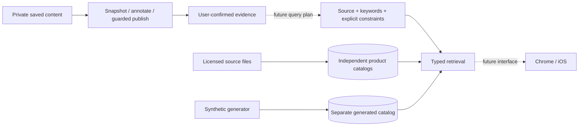

# Mymah Finds local catalog integration

The current build uses licensed local datasets and a separate generated catalog. It needs **no developer account, API key or approval wait**. The eBay integration has been removed. Approved impact/CJ imports remain optional for later merchant access.

## Source inventory

| Source ID | Normalized records | Type / license |
| --- | ---: | --- |
| `abo` | 147,702 | Amazon Berkeley Objects, CC BY 4.0 |
| `wands` | 42,994 | Wayfair WANDS, MIT |
| `open_beauty_facts` | 40,029 | Named metadata, ODbL 1.0; images excluded |
| `open_products_facts` | 25,114 | Named metadata, ODbL 1.0; images excluded |
| `open_food_facts` | 2,999 | Bounded partial sample, ODbL 1.0; images excluded |
| `uci_retail` | 4,949 | Online Retail II historical descriptions, CC BY 4.0 |
| `northwind` | 77 | Microsoft fictional products/suppliers, MIT |
| `adventureworks` | 504 | Microsoft fictional products/vendors, MIT |
| `synthetic` | 20,000 | Generated Mymah products, merchants and offers |
| **Total** | **284,368** | **263,787 real/historical and 20,581 synthetic records** |

These are source records, not globally deduplicated products. ABO identity includes item ID and marketplace domain. UCI II replaces the overlapping original extraction; a whitespace-duplicate stock code is collapsed. One Open Food Facts title was unusable after sanitization. Actual import results are written to `local-data/catalog-load-results.json` and exposed by `/v1/commerce/sources`.

Real-source merchant, price, stock, shipping and purchase URL fields remain null/unknown. A reported store is metadata, not a current seller. Microsoft supplier relationships and reference prices remain fictional attributes without an invented currency. The separate Mymah generator supplies 24 fictional merchants, three currencies, variant families and stock states for controlled testing.

## Load and transfer

Reviewed files are already in this workspace under ignored `local-data/catalog-trials/`. Stop the development API/worker during the initial large SQLite import, then run:

```sh
make catalog-load
make run
```

Each source is atomic and independent: malformed data preserves its previous snapshot, while previously completed sources stay available. Batches are bounded to 1,000 rows; a source can contain at most one million products. Identical version/checksum replays do not duplicate records. Imports never modify private Library/evidence.

Individual imports use the dataset CLI:

```sh
.venv/bin/python -m backend.app.catalog.datasets \
  --source wands --path local-data/catalog-trials/general/wands_products.tsv

.venv/bin/python -m backend.app.catalog.datasets \
  --source synthetic --count 20000 --seed 31
```

ABO takes its directory of sixteen `listings_0.json.gz` through `listings_f.json.gz` shards, with optional `--images local-data/catalog-trials/general/abo_images.csv.gz` for licensed image references. AdventureWorks takes its directory of three extracted JSON tables. Other domain sources take the reviewed JSONL projections, or Northwind's product/supplier JSON. Primary downloads, checksums and actual access trials are documented in [the research report](../reports/Immediately%20usable%20product%20datasets.md).

For another machine, use `make catalog-bundle`. The separate `dist/mymah-finds-catalogs.zip` contains independent compressed source exports, a count/checksum/license manifest and complete notices. It excludes Library/evidence, tokens, affiliate feeds and transaction/customer records. The framework ZIP remains code-only. After extracting the data bundle and applying migrations, restore all sources with verified file hashes and record counts:

```sh
.venv/bin/python scripts/import_catalog_bundle.py /path/to/mymah-finds-catalogs
```

The restore helper validates every manifest/file before writing, then imports each source atomically. To load an individual export manually instead:

```sh
.venv/bin/python -m backend.app.catalog.datasets \
  --source wands --path /path/to/extracted/wands.jsonl.gz \
  --normalized --version VERSION_FROM_MANIFEST
```

Use the actual extracted path and manifest version. Database files, raw downloads and bundles stay out of Git. To withdraw content while retaining import audit metadata:

```sh
.venv/bin/python -m backend.app.catalog.cli revoke \
  --source wands --catalog-id local-dataset
```

A revoked snapshot cannot be silently reactivated by an identical replay; import a newly reviewed version. The additive migration preserves saved Library records. Schema downgrade with dataset content/audit records still present is refused rather than discarding them.

## Shared API and SDKs

All routes use the existing bearer authentication. Reads need no mutation key and return `Cache-Control: no-store`.

| Route | Result |
| --- | --- |
| `GET /v1/commerce/sources` | Configuration, counts, data kind, license and attribution |
| `GET /v1/commerce/search?source=wands&q=desk%20lamp` | Deterministic keyword search in one source |
| `GET /v1/commerce/items/{source}/{record_id}` | Exact source record |
| `GET /v1/commerce/datasets/{source}/export` | Source-isolated JSONL with per-record license/attribution |

Pages contain up to 50 records, with offsets below one million. Indexed SQLite search uses quoted token prefixes joined with AND; punctuation/multilingual edge cases and databases without that index use escaped substring matching. For example, the indexed token `chair` can match `chairs` but not an internal substring in `armchair`. There is no generative ranking or cross-source identity merge. Restart pagination after replacing a snapshot. Unconfigured sources return a non-retryable 503, unknown sources 422, and missing/withdrawn records 404. There is no fallback to another source. Delivery-country filtering is unsupported because these datasets do not establish delivery eligibility.

```js
const sources = await api.catalogSources();
const results = await api.searchProducts({source: 'wands', query: 'desk lamp', limit: 20});
if (results.items.length) {
  const record = await api.catalogItem('wands', results.items[0].source_record_id);
}
```

Swift provides `catalogSources()`, `searchProducts(source:query:limit:offset:)` and `catalogItem(source:id:)`. Offer URL and timestamps are nullable. `CatalogOffer.isExpired(at:) == nil` means unknown expiry, not an evergreen deal; `hasCurrentObservation(at:)` is false without both timestamps. Records carry `data_kind`: `open_dataset`, `synthetic` or `merchant_feed`. Monetary amounts are integer minor units with explicit currency.

## Intelligence boundary



The next AI step can query this corpus using confirmed evidence. It must preserve evidence IDs, distinguish inferred preferences from explicit constraints, and leave money/stock decisions to deterministic checks. The current annotation provider remains deterministic; remote inference, embeddings and recommendation-quality results are not claimed. WANDS query/relevance files are available locally for a held-out retrieval evaluation; do not mix synthetic examples into a real-data quality score without reporting them separately.

The worker already runs inference outside database transactions and publishes only while lease, ownership, saved revision and status match. A remote provider needs a timeout within the 60-second lease or renewal; contextual inference additionally needs an evidence/context version guard.

## Licenses and interface reminders

Per-record provenance retains source IDs, checksums, licenses, attribution and normalization changes. Independent exports keep Open Facts adaptations under ODbL, retain DbCL contents notices, and exclude private/affiliate data. Open Facts images are omitted. ABO image references use CC BY 4.0: retain Amazon.com credit, dataset-builder attribution and the license link when displaying them. MIT sources retain complete notices in the data bundle. See [source notices](catalog-licenses/) and the primary links in the report.

Mymah Finds still has **Library, Search and Profile**; current Search finds saved content. This work adds backend data, not shopping UI. When catalog presentation is added, both teammates must preserve `data_kind`, attribution and unknown values; render source strings as text. Never turn an unknown price into zero/free or missing expiry into current availability. Distinguish synthetic offers from real commerce without adding “prototype” to product copy.

Approved impact/CJ imports remain supported through [the affiliate guide](affiliate-feeds.md). Their separate admission path requires merchant approval and source timestamps and applies offer expiry. Checkout, live tracking, production identity, uploads and push remain separate work.

## Validation

The actual database counts match the source inventory. All 253 backend tests, 31 JavaScript tests and the standalone Swift checks pass. The isolated HTTP workflow and schema checks pass. A full restore of the portable bundle into a fresh migrated database reproduced all 284,368 records with zero private Library records. Six representative local ABO/WANDS searches measured 23–335 ms after indexing; this is a local sample, not a latency guarantee for every query or deployment. PostgreSQL offline SQL was generated; live PostgreSQL and native iOS device builds remain untested.
