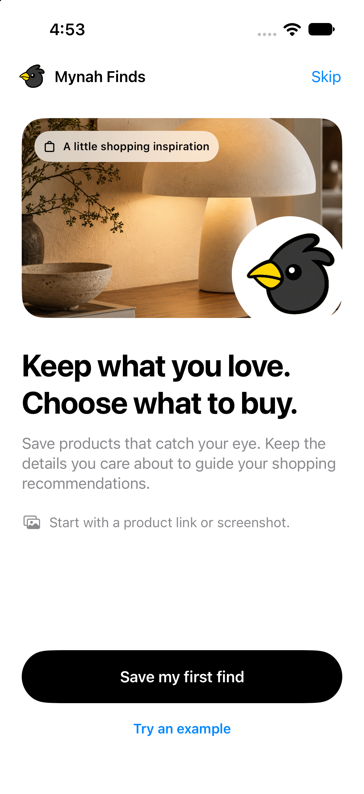
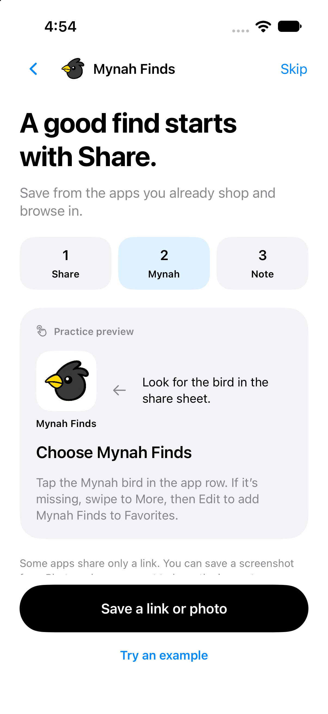
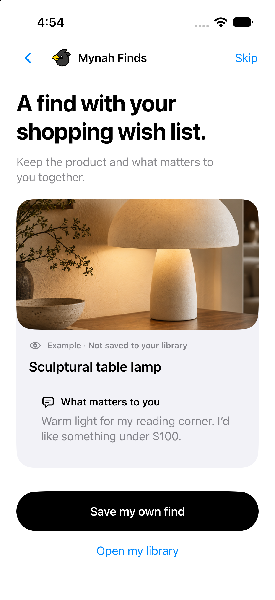
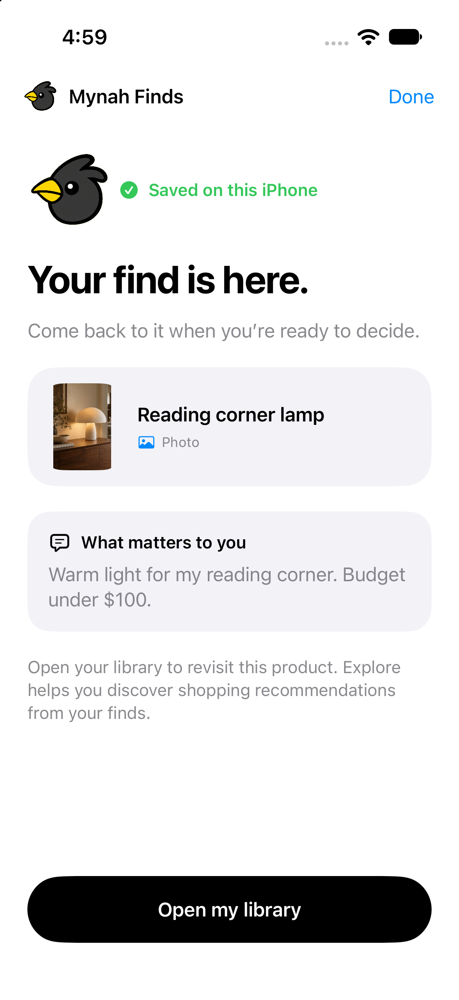

# Shopping onboarding acceptance

The first launch introduces saving shopping finds, demonstrates Share → Mynah Finds → an optional shopping note, and lets the user open the existing capture form immediately. After a durable save, the result uses that item's actual photo, title and note. The lamp preview is explicitly labelled as an example and creates no library entries.

Skip remains available throughout the introduction. The existing completion preference is retained, and Profile → Introduction replays the guide even when the library contains finds. Unfinished onboarding resumes a saved local find after relaunch. Returning from another app imports pending shares through the existing inbox implementation.

## Screens

| Welcome | Sharing walkthrough |
| --- | --- |
|  |  |

| Optional example | Actual first-save result |
| --- | --- |
|  |  |

## Verification performed

2026-10-25, Xcode 27.1, iPhone 17 simulator on iOS 27.0. An isolated bundle ID (`com.aigrandprix.mynahonboardingqa`) kept this verification separate from the installed app.

- Generic simulator build and generic iOS device build passed. Device build was unsigned; this revision was not installed on a physical phone.
- Fresh launch showed the shopping welcome with no import error.
- Tapping the Share and Mynah practice controls advanced the walkthrough. All three steps remained directly selectable; capture was available without completing them.
- Viewing the example and cancelling the capture form left the library empty. Checked on-disk JSON with assertions.
- Skip opened Library and remained completed after app termination/relaunch. Checked the stored preference and the visible Library.
- A real photo picked from Photos, titled `Reading corner lamp`, with note `Warm light for my reading corner. Budget under $100.` produced the actual result screen. Assertions verified exactly one non-sample item, unchanged note/title, and persisted image bytes.
- Terminating before finishing onboarding and reopening restored that saved result. Opening Library then retained the same item and persisted completion.
- Profile → Introduction opened the welcome rather than jumping to the existing saved result; Skip returned to Profile.
- Dark appearance and the largest accessibility text size were inspected. The content scrolled and the completion button remained reachable. Standard size and light appearance were restored afterwards.
- `sh clients/ios/Scripts/local_library_smoke.sh` passed, including local persistence, duplicate grouping, input validation, attachment handling and share replay checks.
- `git diff --check` passed.

After the UI checks, the branch was rebased onto `codex/ios-app` at `96e4d56` (Amazon matching and live pricing) without conflicts. Simulator and unsigned device builds passed again on the combined source. Run `sh clients/ios/Scripts/generate-project.sh` before building so Xcode includes that base branch's new pricing files; `build-simulator.sh` already does this. Generated project changes are excluded from this onboarding PR.

The physical Instagram → Share Extension → return-to-onboarding gesture and live AI recommendations were not exercised. The walkthrough uses instructional previews, and neither the example nor first-save confirmation calls AI. Shopping intelligence still requires the existing separate service configuration.

## Repeat the persistence assertions

Use a fresh, isolated simulator installation. Build with the normal project and `COMMON_THREAD_BUNDLE_PREFIX=com.aigrandprix.mynahonboardingqa`; keep simulator signing enabled for the shared Keychain. Do not reset a personal library to run these checks.

1. View the example, return to the walkthrough, open capture and cancel. Run `preview`.
2. Tap Skip, relaunch without arguments, and run `skipped`.
3. Relaunch the isolated test app with `-resetOnboarding`. Pick the bundled `sculptural-lamp` image through Photos, enter the exact title/note above, and save. Run `saved` while the result is showing. Repeat after relaunch before choosing Done.
4. Choose Open my library and run `completed`. Replay the introduction from Profile, dismiss it, and run `completed` again.

```sh
python3 clients/ios/Scripts/onboarding_smoke.py "$SIM_DEVICE" preview
python3 clients/ios/Scripts/onboarding_smoke.py "$SIM_DEVICE" skipped
python3 clients/ios/Scripts/onboarding_smoke.py "$SIM_DEVICE" saved
python3 clients/ios/Scripts/onboarding_smoke.py "$SIM_DEVICE" completed
```

The script is read-only: it checks simulator storage after the UI action and does not create or delete test content.
