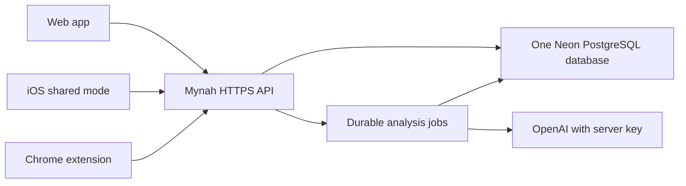

# Shared backend and iOS integration

Reference iOS build: `a4f2c3792a2c674373308cdca7cd66b79227c99c` (Adi's Radar, sharing and appearance update).
Web branch: `codex/mynah-web-app`. API/SDK contract: `0.4.0`.

## Deployment status

The web app and authenticated API are deployed at **https://mynah-finds.vercel.app**.
The Vercel project is `mynah-finds` in `4achime-4427s-projects`, on Hobby. Its Neon
database is `mynah-finds-db`, on Free in Singapore (`sin1`, 1 GB storage).
Use the origin above on iOS, without `/#library` or `/v1` appended.
Account access keys are provisioned privately; none are included in this document.

Production checks passed for authenticated capture, duplicate retry, reading the same
record through a second client, Vercel queue processing, persistence after redeployment,
private images, and deletion. The actual Chrome extension SDK saved a record that the
web SDK then read. Web, iOS and extension request formats were accepted by the live API;
this is not a physical iPhone or installed-extension end-to-end test. Unauthenticated
Library and image requests return 401. Live AI is enabled with a server-side
`OPENAI_API_KEY` stored as a Vercel Production Secret. A real ABO lamp image completed
queued analysis, and two independent clients received the same personalized catalog
records with citations to that saved item. Verification records were removed afterward.
The production model is configured as `gpt-4.1-mini`, matching the native relay's
default model; its shared annotation prompt/contract remains different from that relay.
Hobby usage must meet Vercel's personal, noncommercial-use terms.

The portable long-running-server entrypoint is `python scripts/run_shared.py`. It runs migrations before
starting the existing FastAPI API and web interface on `0.0.0.0:$PORT`.
It requires PostgreSQL and explicit account access keys, and disables demo mutations.
This is a private beta with provisioned account keys, not public signup.

Vercel uses `app.py`, with the following deployment behavior:

- The FastAPI entrypoint requires PostgreSQL and explicit random account keys.
  Alembic migrations were applied before the first deployment; apply future migrations
  before publishing a schema-dependent release. Functions never migrate on a request.
- The embedded worker is disabled. Vercel Queues dispatches bounded jobs, retaining
  PostgreSQL leases, retry budgets, account boundaries and revision checks. Failed
  dispatch is retried by later authenticated database requests and a daily recovery
  cron. Queue payloads contain only job IDs. `CRON_SECRET` protects recovery.
- Keep both clients on the same authenticated API and hosted PostgreSQL database.
  A free database plan has its own storage and compute limits; measure the imported
  catalog and image storage before promising that the complete dataset fits.
- Vercel's 4.5 MB request/response limit means this deployment advertises a 3 MiB
  decoded image limit through capabilities. Web resizes photos to at most 2048 pixels
  and compresses them before upload. iOS must respect `capture.max_image_bytes`
  before base64 encoding; the portable non-Vercel server still permits 4 MiB.

Deployments currently use the CLI from the separate web branch, not an automatic
Git connection: `npx vercel deploy --prod --scope 4achime-4427s-projects`.
Never upload `.env*`, `.vercel/`, local databases or catalog downloads as source.
Those paths are excluded in `.vercelignore`.

[Vercel Hobby limits](https://vercel.com/docs/plans/hobby) currently include
1 million function invocations, 4 active CPU-hours, 360 GB-hours of provisioned
memory, 100 GB of fast data transfer and 10 GB of origin transfer per month.
The first exhausted allowance can interrupt service. These are hosting quotas,
not free AI model calls or a database allocation.
[Function limits](https://vercel.com/docs/functions/limitations) include a maximum
300-second duration on Hobby with Fluid compute and the payload limit above.
Prices and limits were checked on 2026-10-25; verify them again before deployment.

Required environment:

- `DATABASE_URL`: hosted PostgreSQL connection string. Both migrations and the API use psycopg 3.
- `API_TOKENS`: JSON mapping random access keys to account IDs; alternatively
  `MYNAH_ACCOUNT_TOKEN` with `MYNAH_ACCOUNT_ID` for one initial account.
  Generate at least 32 random bytes. Keep values in the hosting secret store, never Git or chat.
- `PORT`: only for the portable server, defaults to `10000`; Vercel manages request serving.
- `ANNOTATION_PROVIDER`: `astra` requires an OpenAI/Astra key; `auto` permits saving
  without AI when no key is configured. Missing analysis is exposed through capabilities.
- `OPENAI_API_KEY` or `ASTRA_API_KEY`, and `ASTRA_MODEL`: server-side only.
  This Vercel project sets `ASTRA_MODEL=gpt-4.1-mini`. GPT-4 models omit the
  unsupported reasoning parameter. The native relay uses a separate prompt/contract;
  changing a hosting URL does not make those equivalent.
- `EXPLORE_CATALOG_SOURCE`: the imported shared catalog source, for example `abo`.
- `CRON_SECRET`: a random secret of at least 32 characters for Vercel's recovery job.
- `EMBEDDED_WORKER=true` is for a portable long-running server only; `app.py` forces it off.

The full official ABO metadata was downloaded with `scripts/prepare_abo_catalog.py`
and imported into the hosted database: **147,702 records**, version
`abo-official-2026-10-25`. Total database size after import was about **703 MB**, leaving
roughly 300 MB on the 1 GB free allocation for saves, images and growth. Monitor storage
before a larger rollout. Live Explore searches for `chair` and `lamp` returned real
catalog records with CC-BY-4.0 attribution in about 1.4 and 0.8 seconds respectively.
The catalog is historical product metadata, not current prices or availability.
Additional sources from Adi's reviewed bundle are not yet available here. Live shared
AI analysis and personalized recommendations were verified against this ABO snapshot.
Haydn can run `make catalog-bundle` on the machine that holds the reviewed datasets.
Transfer the resulting data-only bundle separately; the existing
`scripts/import_catalog_bundle.py` verifies hashes/counts before importing it with
`DATABASE_URL` set to the shared database. Keep source notices and attribution.
Do not copy an iPhone library, a private database, credentials or synthetic test products into that bundle.

## One backend for all three clients

All three clients use `https://mynah-finds.vercel.app` and the same account identity
for the same person's library. The URL alone does not select the account: the bearer
access key resolves to `/v1/me`'s `user_id`. Different people must receive separate
identities. The OpenAI key pays for model inference; it is not a Mynah login and must
never be bundled into the web app, extension or iOS app. The database URL also stays
server-side. Clients save via `POST /v1/saves`, read via `GET /v1/collection`, and read
the account's common recommendations via `GET /v1/explore`.

For the Chrome extension in this branch:

1. Open the extension's **Settings**.
2. Set **Backend origin** to `https://mynah-finds.vercel.app` (no `/v1` or hash).
3. Click **Save and allow backend** and approve that origin in Chrome.
4. Reopen the popup and enter the account access key under **Workspace access**.
   The extension keeps this key in session storage, so it may need re-entry after
   restarting Chrome. Changing origins clears the previous session's credentials.
5. Save a page and refresh the web Library; compare the returned backend record ID.

For the existing iOS build, use the shared connection flow described below. A screen
that says **On this iPhone / Local Library** is still local and has not joined this
shared library. Chrome's capture extension does not currently display an Explore feed.

## User sign-in and branch ownership

This deployment has authenticated private account keys, not end-user registration
or login. Before a wider release, add a managed identity provider and validate its
tokens on the API, mapping a stable verified subject to one account across all three
clients. Do not treat email strings supplied by clients as identity. Persist sessions
securely, support sign-out, and keep account-isolation tests. Existing private-beta
records need an explicit ownership mapping when migrating to login.

No iOS source was changed for this deployment or the web palette update. Do not merge
the whole web branch into the team's active iOS branch. Prepare any native shared-mode,
login, import or Share Extension changes as a separate focused PR based on the current
`codex/ios-app` head, coordinate its scope with the team, and let them review/merge it.
The web branding assets and palette are documented in [web-branding.md](web-branding.md).

To configure or rotate live AI credentials, set `OPENAI_API_KEY` as a **Production Secret** in the Vercel
project's Environment Variables, then redeploy. The key must belong to an OpenAI API
project with available billing; [ChatGPT and API billing are separate](https://help.openai.com/en/articles/9039756-managing-billing-for-chatgpt-and-the-api-platform). Re-analyze saved
items that were captured before AI was enabled, then verify their analysis and shared
Explore citations. Never paste the key into an issue, PR, chat or client configuration.

## What is already in Adi's build

`CommonThreadApp.swift` already has an authenticated shared-account connection path.
It verifies `/v1/me` and capabilities, stores the origin/account in `SharedEnvironment`,
stores the token in Keychain, and loads the shared collection. The Swift SDK already
supports captures, idempotent retries, shared Library search, private images and Explore.
`CaptureForm` can use this connection for supported captures.

Connecting this mode does **not** import `LocalLibrary` or `LocalShareInbox`.
The optional capture-intelligence relay and `POST /v1/recommendations` currently work
from local context. They do not synchronize Library records. Radar also persists locally.

## Haydn's changes

1. Configure the deployed **origin** and the same account access key used on web.
   Preserve `SharedEnvironment` and its `verify` check; use `/v1/me`'s `user_id`,
   never a hardcoded client identity. Different people receive different account keys.
   Never put the OpenAI key or account key in an app bundle or URL.
2. Keep connected Library backed by `collection()`, `searchLibrary()` and
   `savedItem()`. Paginate until `nextOffset` is absent. Refresh on foreground and
   after mutations; this contract does not provide realtime or incremental sync.
3. Use `CaptureOutbox` for connected host and Share Extension saves. Persist the
   payload and `MutationKey` before sending `capture(_:key:)`; retain both after
   timeouts and retry with the same key. Scope the outbox to origin and account.
   Check App Group/Keychain entitlements for both targets. A group-free local build
   must explicitly transfer inbox entries to the host outbox; it cannot assume a shared directory.
4. Add an explicit import of existing local finds. Record a durable mapping from
   local find ID to backend ID separately for each account/origin. Preserve local
   originals until the server receipt is verified, and make retries safe. The current
   capture API accepts URL or one JPEG/PNG/WebP image (3 MiB decoded on this deployment),
   not arbitrary files, audio/video, text-only finds or multi-attachment records.
   Leave unsupported items local and explain which were not imported. Do not drop them.
   URL/image deduplication can return an existing item without merging notes; surface
   that conflict rather than claiming every local field was imported.
5. In connected Explore, use `CommonThreadClient.explore()` (`GET /v1/explore`),
   the same endpoint as web. Render saved-find evidence and catalog citations from
   that response. Refresh after captures, selected/edited/rejected annotations and
   deletion. Do not continue using local `POST /v1/recommendations` and describe it
   as the shared account's feed: its request and ranking engine are different.
6. Use server analysis and suggestions for connected records. Follow
   `analysis_status`, `analyzeSave(_:key:)` and `respond(to:with:key:)`.
   A pending or failed analysis must not turn a successful save into a failed save.
   Existing local preview analysis/chosen chips are not accepted as trusted server
   analysis by this capture contract. Preserve them locally; import user-approved
   context as notes/annotation edits with appropriate length checks.
7. Use `savedImage()` with authorization and `deleteSavedItem(_:key:)` for shared
   records. Clear account-specific images, cached recommendations and pending UI
   state on sign-out/account change; cancel stale responses.

Radar's `intent-radar.json`, pins, favorites, archives and local attachment metadata
are not synchronized by contract 0.4.0. The existing shared price-watch endpoint is
not a compatible replacement for native product/brand/category/need Radar watches.
Keep this boundary visible until a reviewed shared Radar contract is implemented.
There is no live price monitor or notification delivery in this deployment.

## Acceptance before calling it synchronized

- Save a real link/image on web and see the same backend ID in iOS after refresh.
- Save from the host and from the Share Extension and see both on web.
- Retry an interrupted capture without creating a duplicate; switch accounts with
  pending entries and verify they never upload into the other account.
- Import the same local library twice without duplicates or lost unsupported files.
- With a configured provider and licensed catalog, verify real recommendations on
  both clients from the same saved context, including the cited saved IDs.
- Delete a find on either client; verify it disappears and stops supporting recommendations.
- Restart/redeploy the service and verify saves/images remain. Check a second account
  cannot list, read, retrieve images from or delete the first account's records.

Physical iPhone/Share Extension and installed Chrome extension acceptance remain
required. Live API analysis and recommendations across two independent clients passed;
that does not replace testing the installed apps. User-facing sign-in is the next step
after this private demo, per the demo owner's decision.
